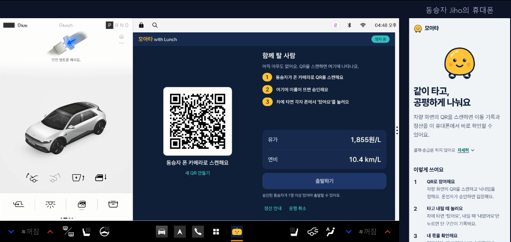
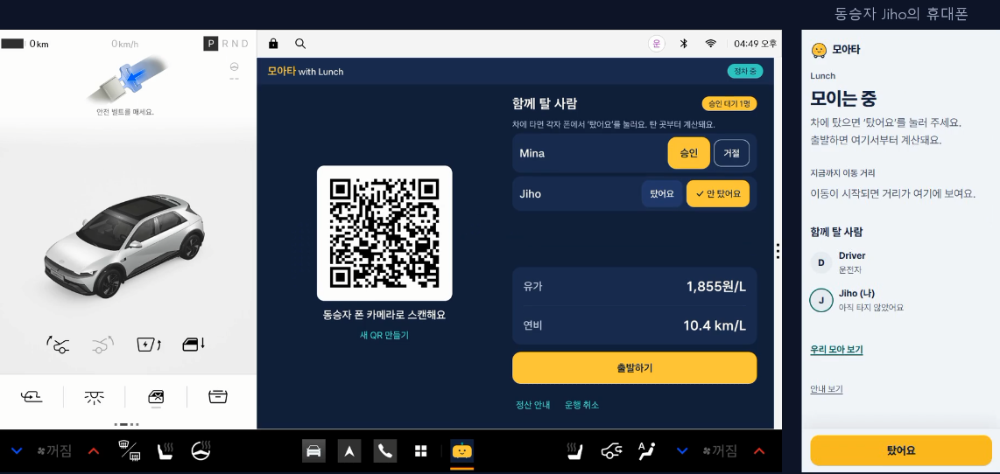
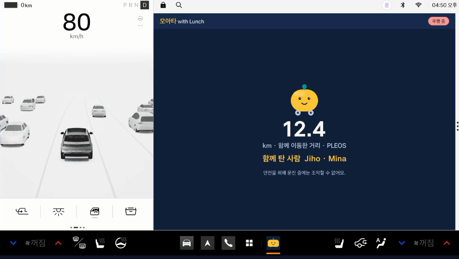
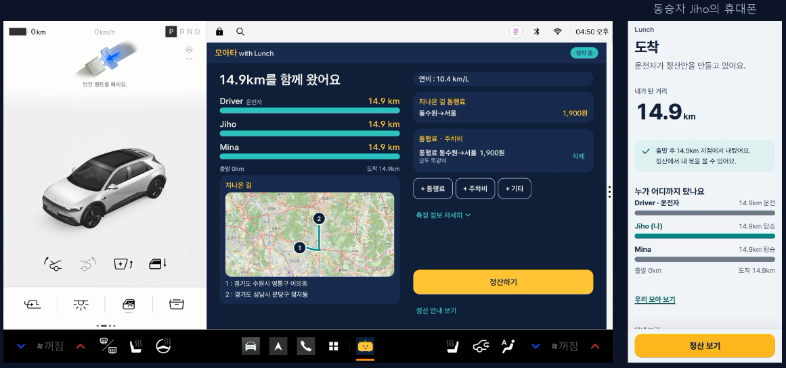
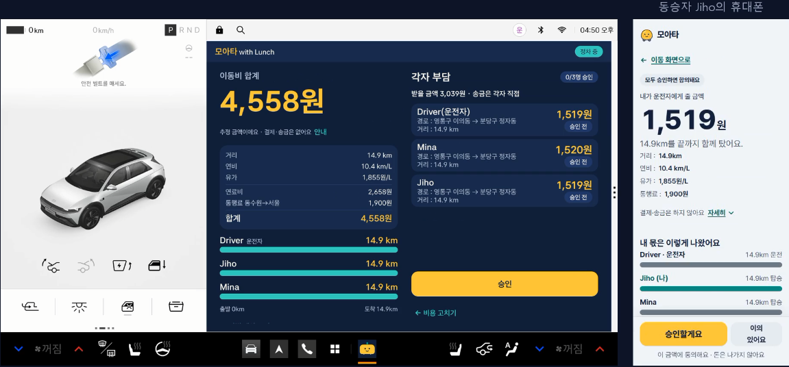
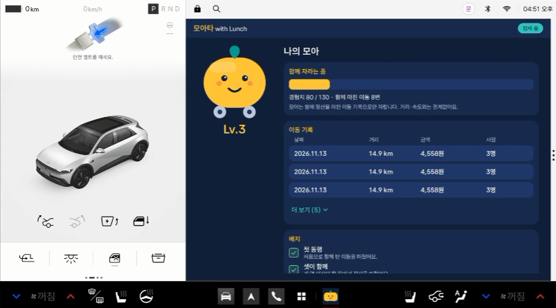

# MOATA (모아타)

Hyundai/42dot **Pleos Connect** 차량 앱, 동승자 모바일 웹, FastAPI 서버로 구성한 **지인 그룹 이동 기록, 구간별 비용 분담, 캐릭터 ‘모아’ 성장** 서비스입니다.

공개 유상 카풀 매칭이나 결제 및 송금 서비스가 아닙니다. 정산 금액은 차량 정보와 연비, 단가를 기준으로 계산한 **참고용 추정치**입니다.

## 구성

| 폴더 | 내용 |
|---|---|
| [`car-app/`](car-app) | Kotlin, Jetpack Compose, Room, Pleos Vehicle SDK 기반 Android Automotive 차량 앱 |
| [`passenger-web/`](passenger-web) | Next.js, TypeScript 기반 모바일 웹(QR 참가, 탑승 및 하차, 정산 확인, 모아) |
| [`backend/`](backend) | FastAPI, SQLAlchemy, Alembic, PostgreSQL/SQLite 기반 API와 비용 계산 엔진 |
| [`contracts/`](contracts) | 서버에서 생성하고 테스트로 동기화를 확인하는 OpenAPI 계약 |
| [`docs/`](docs) | 데모 실행 절차와 법적 고지 및 개인정보 안내 |
| [`scripts/`](scripts) | 백엔드 및 전체 데모 실행, E2E 확인, 에뮬레이터 조작 스크립트 |
| [`artifacts/`](artifacts) | 제출용 데모 APK, 시연 영상, 주요 앱 화면 |

문서: [데모 실행 가이드](docs/DEMO_RUNBOOK.md), [법적 고지 및 개인정보 안내](docs/LEGAL_AND_PRIVACY.md)

## 빠른 시작 (백엔드)

Python 3.12와 `uv` 사용을 권장합니다.

```bash
cd backend
uv venv --python 3.12 .venv
uv pip install -r requirements-dev.txt --python .venv/bin/python
.venv/bin/python -m pytest -q

cd ..
scripts/run_backend.sh
python3 scripts/demo_e2e.py
```

API 문서는 서버 실행 후 `http://localhost:8000/api/v1/docs`에서 확인할 수 있습니다. 환경 변수는 [`.env.example`](.env.example)을 참고하고 실제 비밀값은 저장소에 추가하지 않습니다. 휴대폰에서 접속할 때는 `MOATA_CORS_ORIGINS`에 `http://<PC의 LAN IP>:3000`을 추가해야 합니다.

## 승객 웹, 차량 앱, 전체 데모 실행

승객 웹은 Node.js 22 이상에서 실행합니다.

```bash
cd passenger-web
npm ci
npm run lint
npm run typecheck
npm test
npm run build
npm run dev
```

차량 앱은 JDK 17과 Android SDK가 필요합니다.

```bash
cd car-app
./gradlew :app:assembleDebug :app:testDebugUnitTest :app:lintDebug
adb install -r ../artifacts/MOATA.apk
```

백엔드와 승객 웹을 함께 실행할 수 있습니다.

```bash
scripts/run_demo.sh
```

## 제출 자료

| 자료 | 파일 | 설명 |
|---|---|---|
| 데모 APK | [`artifacts/MOATA.apk`](artifacts/MOATA.apk) | Android Automotive 설치용 APK |
| 데모 영상 | [`artifacts/moata_demo.mp4`](artifacts/moata_demo.mp4) | 주요 사용자 흐름 시연 영상 |
| 앱 화면 | [`artifacts/UI/`](artifacts/UI) | 차량 앱과 동승자 웹의 대표 화면 6장 |

`MOATA.apk` SHA-256: `90A13A6ECF9B43DAD998EFF310C3DFAD47F6C64263D2718CCDF47D58229616AB`

## 주요 화면

| 그룹 참가 | 동승자 참가 |
|---|---|
|  |  |

| 주행 | 운행 요약 |
|---|---|
|  |  |

| 정산 | 모아 |
|---|---|
|  |  |

## 법적 및 운영 고지

- 비용 분담의 적법성은 이용 상황에 따라 달라질 수 있으며, 서비스가 이를 보장하지 않습니다. 지인 그룹 간 비영리 비용 분담 목적으로만 사용해야 합니다.
- 쿠폰은 시연용이며 실제로 교환할 수 없습니다. 실제 기프티콘 제공에는 별도 제휴와 승인이 필요합니다.
- 닉네임만 저장하며 VIN, 전화번호, 실명, 위치 좌표는 저장하지 않습니다.
- 그룹 삭제와 보존기간 만료 데이터 정리 기능을 제공합니다. 자세한 내용은 [법적 고지 및 개인정보 안내](docs/LEGAL_AND_PRIVACY.md)를 참고하세요.
